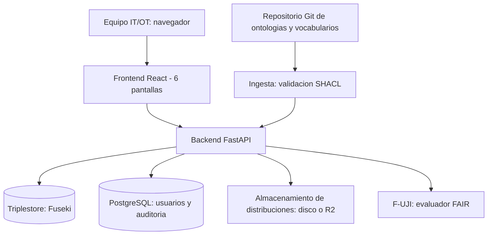

# Arquitectura

Fuente: `Plan.md` (secciones 1 y 4) y las decisiones en [adr/](adr/README.md). Este documento describe la arquitectura objetivo y marca qué existe hoy. No describe detalles de implementación que aún no existen.

## Estado actual

En la fase 1 existen:

- **Backend:** FastAPI con JWT, y usuarios y auditoría en PostgreSQL.
- **Frontend:** esqueleto con navegación y login.
- **`semantic/`:** patrón de URIs, formas SHACL mínimas y un ejemplo.
- **Infraestructura:** Docker Compose con postgres, Fuseki, backend y frontend, y CI en GitHub Actions.

En la fase 2 se añaden:

- **Backend:** ingesta de datasets con validación SHACL, lectura pública del catálogo y URIs persistentes de dataset con negociación de contenido.
- **Frontend:** catálogo y ficha de dataset, con los datasets sintéticos (ADR 0016).
- **`semantic/`:** comando `load-semantic` para cargar los datos sintéticos.

En la fase 3 se añaden (ADR 0020 a 0025):

- **Backend:** lectura pública de esquemas SKOS, vocabularios y ontologías (`/schemes`, `/vocabularies`, `/ontologies`) y URIs persistentes `/onto/...` y `/vocab/...` con negociación de contenido. En la ingesta calcula las métricas OWL de cada versión de ontología con owlready2, sin Java (ADR 0021), y comprueba su consistencia con Pellet, que sí necesita Java en la imagen del backend y razona sin las ontologías importadas (ADR 0022). El perfil OWL es aproximado y la expresividad DL no se calcula.
- **`semantic/`:** ontologías y vocabularios sintéticos, marcados como tales (ADR 0020), que `load-semantic` carga con sus métricas.
- **Publicación:** una etiqueta de Git (`onto/{slug}/v{version}`, `vocab/{slug}/v{version}` o `vocab/corp/{slug}/v{version}`) dispara en GitHub Actions la validación SHACL, la documentación (WIDOCO para ontologías; una página HTML sencilla para esquemas SKOS) y una Release con el RDF. La Release no despliega nada: la carga en un entorno es manual con `load-semantic` hasta la fase 5 (ADR 0025). Detalle en [`infra/README.md`](../infra/README.md).

En la fase 4 (contrato de G4) se añaden:

- **F-UJI** como servicio interno, con la evaluación FAIR de cada versión de dataset nueva (ADR 0036).
- **Ficheros de distribución** en el almacenamiento, con su descarga según `dct:accessRights` (ADR 0031).
- **SPARQL público** a través del backend, con límites (ADR 0033), y **consultas guardadas** (ADR 0034).
- **Versiones inmutables** (ADR 0027), límite de intentos de login y revocación de tokens (ADR 0026) y usuario de escritura propio del backend en Fuseki.

Todo lo demás es objetivo de fases posteriores y está marcado como [Posterior].

Leyenda: **[Fase 1]**, **[Fase 2]** y **[Fase 3]** existen hoy; **[Fase 4]** lo fija el contrato de la fase 4 y se integra en esa fase; **[Posterior]** objetivo de fases posteriores.

## Componentes

| Componente | Función | Alcance |
|---|---|---|
| Frontend (React, TypeScript, Vite, React Router, Vitest) | Las 6 pantallas del prototipo: Catálogo, Ficha de dataset, Vocabularios y ontologías, Ficha de ontología, Navegador SKOS y Consola SPARQL. Login JWT desde el cliente | [Fase 1] esqueleto mínimo con login; [Fase 2] Catálogo (búsqueda, filtros por dominio y tipo, tarjetas) y Ficha de dataset (versionado, distribuciones, PROV-O, RDF, metadatos DCAT-AP; FAIR con «Disponible en la fase 4», sustituido en la fase 4 por la evaluación de F-UJI, ver la fila de F-UJI); [Posterior] el resto de pantallas |
| Backend (Python, FastAPI) | Catálogo DCAT-AP, versionado, control de acceso JWT, orquestación FAIR, métricas OWL, endpoint SPARQL, negociación de contenido sobre URIs persistentes | [Fase 1] JWT, roles, usuarios; [Fase 2] ingesta y lectura del catálogo, URIs persistentes y herencia de permisos del admin sobre el editor; [Posterior] el resto |
| Triplestore (Apache Jena Fuseki; GraphDB Free como alternativa) | Almacén RDF del catálogo, ontologías y vocabularios | [Fase 1] en el Compose; [Fase 2] el backend escribe con credenciales (grafo con nombre por serie) y lee de forma anónima; Fuseki rechaza las escrituras anónimas |
| PostgreSQL | Usuarios y auditoría | [Fase 1]; [Fase 4] además: ficheros de distribución, evaluaciones FAIR, consultas guardadas personales e intentos de login |
| Almacenamiento de distribuciones | Interfaz con dos implementaciones, disco (MVP) y Cloudflare R2 (despliegue), elegida por configuración (`STORAGE_BACKEND`). Guarda los ficheros con la clave `{slug}/{version}/{dist}`; su tamaño y su suma de comprobación van en PostgreSQL | [Fase 4] |
| F-UJI | Evaluador FAIR como servicio interno, sin puertos publicados en el host: solo el backend lo llama. Puntuación por versión | [Fase 4] |
| Ingesta | Validación con formas SHACL y carga al triplestore, siempre mediante el backend | [Fase 2] para datasets |
| Repositorio Git de ontologías y vocabularios | Fuente de verdad; solo se publican versiones etiquetadas, y cada etiqueta dispara validación, documentación y publicación (CI) | [Fase 3] |

## Reglas de arquitectura

1. Solo el backend escribe en el triplestore y en el almacenamiento, de modo que versionado, permisos y FAIR pasan siempre por el mismo punto.
2. Las ontologías y los vocabularios viven en Git; el catálogo solo publica versiones etiquetadas.
3. Toda ingesta se valida con las formas SHACL.
4. Todas las URIs se construyen a partir de la variable de entorno `BASE_URI` (ADR 0006).
5. Los datasets restringidos de defensa solo publican metadatos; sus distribuciones se quedan en infraestructura de Eurecat.

## Estándares

DCAT-AP 3 (con series y versiones de DCAT 3), SKOS, OWL 2 con VANN, PROV-O y SHACL.

## Autenticación y roles

JWT emitido y verificado dentro del backend, sin SSO en el MVP. Roles: lector (anónimo), miembro, editor y admin (ADR 0011). El primer admin se crea por CLI y el resto los da de alta el admin desde la API (ADR 0015).

## Flujos

| Flujo | Descripción | Alcance |
|---|---|---|
| Login | El frontend envía credenciales al backend, que valida contra PostgreSQL y devuelve un JWT; el frontend lo usa en las llamadas siguientes | [Fase 1] |
| Publicación de un dataset | Un editor o admin envía metadatos con `POST /datasets`; el backend los valida con SHACL y los escribe en un grafo con nombre por serie en Fuseki. La lectura pública es `GET /datasets`, `GET /datasets/{slug}` y `GET /datasets/{slug}/rdf`. Las URIs persistentes `/dataset/{slug}[/{version}]` negocian contenido (Turtle o JSON-LD) y redirigen con 303 a la ficha del frontend. El comando `load-semantic` carga los datasets sintéticos (ADR 0016) | [Fase 2]; [Fase 4] la evaluación FAIR con F-UJI (flujo «Evaluación FAIR») y el guardado de distribuciones en el almacenamiento (flujo «Subida y descarga de distribuciones») |
| Publicación de ontologías y vocabularios | Una etiqueta de versión en Git dispara validación, documentación y publicación (Release de GitHub); la carga en el triplestore se hace con `load-semantic` (ADR 0025) | [Fase 3] |
| Consulta SPARQL | El frontend y cualquier cliente consultan `/sparql` en el backend, que valida la consulta (solo lectura, sin `SERVICE`) y la ejecuta contra el endpoint de solo lectura de Fuseki, con tiempo máximo, número máximo de filas y límite de frecuencia (ADR 0033) | [Fase 4] |
| Consultas guardadas | Las de referencia se leen de `semantic/consultas/` y las ve todo el mundo; las personales se guardan en PostgreSQL y solo las ve su dueño (ADR 0034) | [Fase 4] |
| Evaluación FAIR | Al publicar una versión nueva de dataset, el backend encola su evaluación en F-UJI en segundo plano, sin bloquear la publicación. F-UJI evalúa el RDF Turtle de la versión bajo `FAIR_TARGET_BASE_URL`, no la URI persistente (que redirige al frontend, inalcanzable desde `fuji-net`), y el backend guarda el resultado en PostgreSQL con el informe completo. Si F-UJI falla, la evaluación queda como fallida y la API sigue funcionando (ADR 0036) | [Fase 4] |
| Subida y descarga de distribuciones | Un editor sube un fichero a una distribución; el backend lo escribe en el almacenamiento y guarda tamaño y suma de comprobación en PostgreSQL. El RDF publicado no cambia. La descarga depende de `dct:accessRights`: `PUBLIC` abierta, `RESTRICTED` para usuarios autenticados con auditoría, `NON_PUBLIC` solo metadatos y sin fichero (ADR 0031). Según el contrato, el navegador obtiene un enlace firmado de corta vida para no poner el JWT en la URL | [Fase 4] |
| Descarga de distribución restringida | Cada ruta enumera los roles que admite; el admin hereda los permisos de editor y el resto de roles no hereda nada (ADR 0017). Según `Plan.md`, el miembro puede solicitar o descargar distribuciones restringidas | [Fase 4]: ver «Subida y descarga de distribuciones» |

## Contratos entre capas

| Contrato | Dueño | Consumidores |
|---|---|---|
| Especificación OpenAPI de la API | `backend` | `frontend`, `qa`, `docs` |
| Formas SHACL (DCAT-AP 3 y reglas propias) | `semantico` | `backend` (ingesta), `qa` |
| Patrón de URIs persistentes | `semantico` | `backend`, `frontend` |
| Docker Compose y variables de entorno | `infra` | todos |
| Datos de ejemplo del prototipo | `semantico` | `backend`, `frontend`, `qa` |

Cambiar un contrato exige una PR propia, revisada antes que las PR que dependen de ella.

## Entorno

Docker Compose local. Alcance de la fase 1: postgres, Fuseki, backend y frontend (ADR 0014). Desde la fase 4 el entorno incluye también F-UJI, como servicio interno en la red `fuji-net` (`internal: true`, sin salida a internet y sin puertos en el host), compartida con el backend. El proveedor cloud se decide en el piloto (fase 5).

En la fase 4 el backend escribe en Fuseki con un usuario propio (`backend`), y el usuario `admin` queda para administración. Las consultas anónimas de solo lectura siguen como hasta ahora: las usa el backend para el SPARQL público.

Operación del entorno local, incluida la recarga desde cero: [operacion.md](operacion.md).
