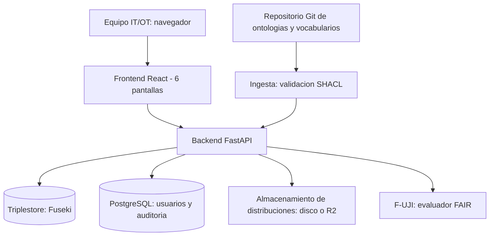

# Arquitectura

Fuente: `Plan.md` (secciones 1 y 4) y las decisiones en [adr/](adr/README.md). Este documento describe la arquitectura objetivo y marca qué existe hoy. No describe detalles de implementación que aún no existen.

## Estado actual

Fase 1 en curso. En `main` solo hay `Plan.md`, `CLAUDE.md` y `.claude/agents/`. Backend, frontend, infraestructura y `semantic/` se están creando en paralelo y se documentarán aquí cuando existan.

Leyenda: **[Fase 1]** objetivo de la fase actual; **[Posterior]** objetivo de fases posteriores.

## Componentes

| Componente | Función | Alcance |
|---|---|---|
| Frontend (React, TypeScript, Vite, React Router, Vitest) | Las 6 pantallas del prototipo: Catálogo, Ficha de dataset, Vocabularios y ontologías, Ficha de ontología, Navegador SKOS y Consola SPARQL. Login JWT desde el cliente | [Fase 1] esqueleto mínimo con login; [Posterior] las 6 pantallas |
| Backend (Python, FastAPI) | Catálogo DCAT-AP, versionado, control de acceso JWT, orquestación FAIR, métricas OWL, endpoint SPARQL, negociación de contenido sobre URIs persistentes | [Fase 1] JWT, roles, usuarios; [Posterior] el resto |
| Triplestore (Apache Jena Fuseki; GraphDB Free como alternativa) | Almacén RDF del catálogo, ontologías y vocabularios | [Fase 1] en el Compose; [Posterior] uso desde la ingesta |
| PostgreSQL | Usuarios y auditoría | [Fase 1] |
| Almacenamiento de distribuciones | Interfaz con dos implementaciones, disco (MVP) y Cloudflare R2 (despliegue), elegida por configuración | [Posterior] |
| F-UJI | Evaluador FAIR como servicio interno; puntuación por versión | [Posterior] fase 4 |
| Ingesta | Validación con formas SHACL y carga al triplestore, siempre mediante el backend | [Posterior] fase 2 |
| Repositorio Git de ontologías y vocabularios | Fuente de verdad; solo se publican versiones etiquetadas, y cada etiqueta dispara validación, documentación y publicación (CI) | [Posterior] fase 3 |

## Reglas de arquitectura

1. Solo el backend escribe en el triplestore y en el almacenamiento, de modo que versionado, permisos y FAIR pasan siempre por el mismo punto.
2. Las ontologías y los vocabularios viven en Git; el catálogo solo publica versiones etiquetadas.
3. Toda ingesta se valida con las formas SHACL.
4. Todas las URIs se construyen a partir de la variable de entorno `BASE_URI` (ADR 0006).
5. Los datasets restringidos de defensa solo publican metadatos; sus distribuciones se quedan en infraestructura de Eurecat.

## Estándares

DCAT-AP 3 (con series y versiones de DCAT 3), SKOS, OWL 2 con VANN, PROV-O y SHACL.

## Autenticación y roles

JWT emitido y verificado dentro del backend, sin SSO en el MVP. Roles: lector (anónimo), miembro, editor y admin (ADR 0011). El primer admin se crea por CLI y el resto los da de alta el admin desde la API (ADR 0015).

## Flujos

| Flujo | Descripción | Alcance |
|---|---|---|
| Login | El frontend envía credenciales al backend, que valida contra PostgreSQL y devuelve un JWT; el frontend lo usa en las llamadas siguientes | [Fase 1] |
| Publicación de un dataset | Un editor envía metadatos al backend, que los valida con SHACL, los carga en el triplestore, guarda las distribuciones en el almacenamiento y lanza la evaluación FAIR | [Posterior] fases 2 y 4 |
| Publicación de ontologías y vocabularios | Una etiqueta de versión en Git dispara validación, documentación y publicación | [Posterior] fase 3 |
| Consulta SPARQL | El frontend consulta a través del backend, que expone o hace de proxy del endpoint | [Posterior] fase 4 |
| Descarga de distribución restringida | Solo para miembros o superior | [Posterior] fase 4 |

## Contratos entre capas

| Contrato | Dueño | Consumidores |
|---|---|---|
| Especificación OpenAPI de la API | `backend` | `frontend`, `qa`, `docs` |
| Formas SHACL (DCAT-AP 3 y reglas propias) | `semantico` | `backend` (ingesta), `qa` |
| Patrón de URIs persistentes | `semantico` | `backend`, `frontend` |
| Docker Compose y variables de entorno | `infra` | todos |
| Datos de ejemplo del prototipo | `semantico` | `backend`, `frontend`, `qa` |

Cambiar un contrato exige una PR propia, revisada antes que las PR que dependen de ella.

## Entorno

Docker Compose local. Alcance de la fase 1: postgres, Fuseki, backend y frontend (ADR 0014). F-UJI se añade en la fase 4. El proveedor cloud se decide en el piloto (fase 5).
